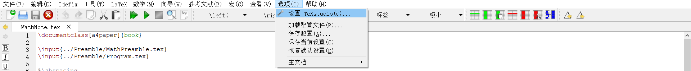
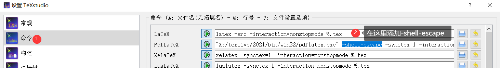
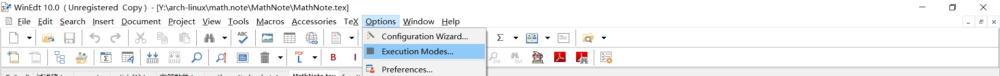
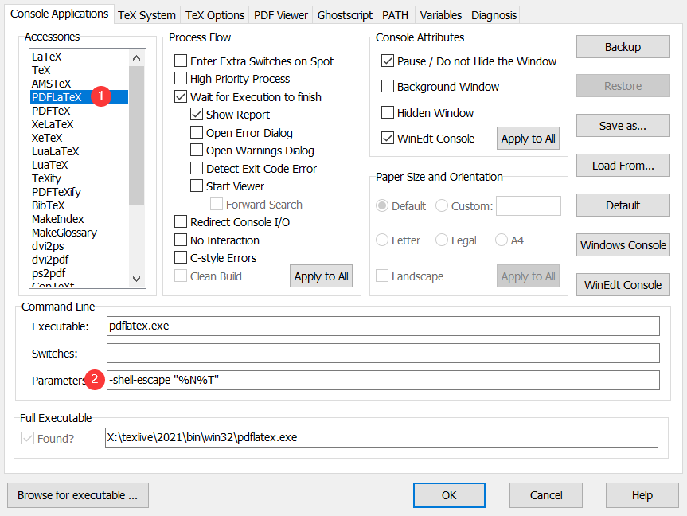

# 数学笔记

这是我的个人数学笔记, 里面的题目大多来源于书籍与互联网, 解题方法有些是我本人提供的, 有些则来自网络.

可能存在的问题欢迎大家提交 issue 告知.

## 关于解答详细程度的说明

1. 我们都知道学习数学重在思考, 我不是一个喜欢伸手党的人.
2. LaTeX 编写数学公式是一件比较耗时的工作, 虽然我认为 LyX 已经很好的加快了我的编码速度.
3. 笔记写的太过详细就不是个人笔记了, 会导致 `我本人` 阅读到冗余信息, 所以所有的题目解答都是以 `比提示稍微丰富一点` 的方式展示关键过程.

## 目录结构

```
MathNote/            主笔记, 入口文件为 MathNote.tex
Preamble/            导言区与宏定义 (MathPreamble.tex)
Stack/               独立示例文档 sample-book.tex (tex 笔记: tikz/pstricks/asymptote 用法)
asymptote/           独立编译的 Asymptote 图源文件
snippt/              零散的 LyX/TeX 片段与试卷草稿
article.notes/       单篇文章笔记 (LyX)
archive/             归档内容
pic/                 README 与笔记使用的图片
```

## 新增章节的写法

1. 在 `MathNote/` 下新建 `xxx.tex`, 第一行写 `\chapter{...}` (或 `\section{...}`).
2. 在 `MathNote/MathNote.tex` 的正文区域用 `\input{xxx.tex}` 引入, 顺序即章节顺序.
3. 中文与英文/公式之间不必手动敲空格, `xelatex` 下由 `xeCJK` 自动处理.
4. 定理/定义等环境已由导言区的 `tcolorbox` 定义好, 可直接用 `\begin{theorem} ... \end{theorem}` 等, 也可用导言区提供的缩写 (如 `\bt`/`\et`).

## 编译说明

### 环境依赖

| 依赖 | 用途 | 说明 |
| --- | --- | --- |
| TeX Live 或 MiKTeX (完整版) | 排版 | 需要 `book` 文档类, `iftex`, `xeCJK`, `CJKutf8`, `tcolorbox`, `minted`, `pgfplots`, `asymptote`, `pstricks`, `fourier` 等宏包 |
| Python 包 `Pygments` | `minted` 代码高亮 | 必须安装, 且命令需在 `PATH` 中 |
| Asymptote (`asy`) | 编译 `MathNote-*.asy` 图 | 可选, 仓库已附带生成的 `MathNote-1.pdf` |
| gnuplot | `note8.tex` 中的部分绘图 | 可选, 仓库已保留 `.pgf-plot.gnuplot` 与 `.pgf-plot.table` 文件 |
| `makeindex` | 生成索引 | TeX 发行版自带 |

因为使用了 `minted`, **编译时必须加 `-shell-escape` 参数**. 缺少 Pygments 时 `minted` 代码块会失败:

```bash
pip install Pygments
```

### 编译器选择: XeLaTeX 与 pdfLaTeX 都可用

导言区 (`Preamble/MathPreamble.tex`) 用 `iftex` 做了引擎分支, 两种引擎都能直接编译:

| 引擎 | 中文方案 | 中英文自动间距 | 说明 |
| --- | --- | --- | --- |
| `xelatex` (默认推荐) | `xeCJK` | 有 | 借助 `CJKecglue`, 中文与英文/公式之间自动留白 |
| `pdflatex` | `CJKutf8` + `CJK` 环境 | 无 | `CJK` 宏包本身没有中英文间隙机制 |

导言区代码:

```latex
\usepackage{iftex}
\usepackage[T1]{fontenc}
\ifPDFTeX
  % pdfLaTeX: CJK 宏包 + 正文里的 CJK 环境
  \usepackage{CJKutf8}
\fi
\ifXeTeX
  % XeLaTeX: xeCJK 提供自动中英文间距
  \usepackage{xeCJK}
  \xeCJKsetup{CJKecglue={\hskip 0.3em plus 0.1em minus 0.1em}}
  % 正文中的 CJK 环境在 xeCJK 下多余, 定义为空以免改动正文
  \newenvironment{CJK}[2]{}{}
\fi
\ifPDFTeX\else\ifXeTeX\else
  \PackageWarningNoLine{MathPreamble}{Only pdfLaTeX and XeLaTeX are supported}
\fi\fi
```

- 间距宽度由 `CJKecglue` 控制, 默认约为 1/3 汉字宽且可伸缩. 觉得偏宽可改成 `0.25em`.
- `\begin{CJK}{UTF8}{gbsn} ... \end{CJK}` 写在正文里, 在 `pdflatex` 下由 `CJKutf8` 处理, 在 `xelatex` 下被定义为空环境, 因此 **正文无需改动**.
- 旧的 `zhspacing` 宏包只支持 XeTeX (在 `pdflatex` 下会报 `! XeTeX required to use zhspacing.`), 已从导言区移除, 由 `xeCJK` 取代.
- 目前不支持 LuaLaTeX (会给出明确警告), 如需支持应改用 `luatexja`.

### 中文字体: 按系统自动选择

`xelatex` 下导言区用 `\IfFontExistsTF` 依次探测本机已安装的中文字体, 因此 Linux 与 Windows 可以直接共用同一份源码:

1. `FandolSong-Regular` / `FandolHei-Regular` / `FandolFang-Regular` — TeX Live 自带, 各平台通用 (首选)
2. `SimSun` / `SimHei` / `KaiTi` / `FangSong` — Windows 中易字体
3. `Source Han Serif SC` / `Source Han Sans SC` — Linux 思源字体
4. `Noto Serif CJK SC` / `Noto Sans CJK SC` — Linux Noto
5. `AR PL UMing CN` / `AR PL UKai CN` — 文鼎字体 (兜底)

因此通常不需要手动配置字体. 若要改用其他字体, 只需修改导言区中对应的 `\setCJKmainfont` 等命令.

### 用 Makefile 编译 (Linux/macOS)

`MathNote` 文件夹内提供了一个简单的 `Makefile`, 配好 `make` 后直接在该目录执行:

```bash
make                  # 默认用 xelatex 编译 (有中英文间距)
make ENGINE=pdflatex  # 改用 pdfLaTeX 编译
make clean            # 清除产物
```

`Makefile` 的核心变量:

```make
ENGINE ?= xelatex
TEX=$(ENGINE) --synctex=1 -shell-escape -interaction=nonstopmode
ASY=asy
```

注意 `Makefile` 末尾用 `okular` 打开 PDF, 如果本机使用其他阅读器 (如 `evince`), 请自行修改该行.

### 用命令行编译 (Linux/Windows 通用)

Windows 上没有 GNU `make` 时, 可直接在 `MathNote` 目录执行等价命令. 为了让目录与交叉引用正确, 需要编译两遍并生成索引:

```bash
xelatex -shell-escape -interaction=nonstopmode MathNote.tex
asy MathNote-*.asy
makeindex MathNote.idx
xelatex -shell-escape -interaction=nonstopmode MathNote.tex
xelatex -shell-escape -interaction=nonstopmode MathNote.tex
```

若用 `pdflatex`, 把上面的 `xelatex` 换成 `pdflatex` 即可 (此时中英文之间不会自动留白).

更省事的方式是用 `latexmk` 自动处理多遍编译:

```bash
latexmk -xelatex -shell-escape MathNote.tex   # 或 latexmk -pdf -shell-escape MathNote.tex
```

若希望 `asy` 生成的图也使用 XeLaTeX 引擎 (图形含文字时更统一), 可用 `asy -tex xelatex MathNote-*.asy`.

### TeXstudio (TeX Live) 中的配置

需要给编译器加上 `-shell-escape`:





### CTeX 的 WinEdt 编辑器中的配置





## 补充工具的搭建

在 `MathNote/note8.tex` 文件中有一部分绘图代码使用了 `gnuplot` 工具. 这个工具的 Windows 版本可以在[这里](http://tmacchant33.starfree.jp/gnuplot_bin.html)下载, 官网在[这里](http://www.gnuplot.info/).

所以要在编辑器的 `选项 → 设置 TeXstudio → 构建 → 命令($PATH)` 处补充添加 `PATH` 环境变量, 即添加 `path\to\gnuplot\bin`, 配置方式类似下面的说明, 图文部分略去.

对于 WinEdt 编辑器, 则需要在 `Options → Execution Modes... → PATH` 中的 `Extra PATH Folders` 中添加 `path\to\gnuplot\bin`.

这个工具会在 `MathNote` 目录下生成以 `.pgf-plot.gnuplot` 和 `.pgf-plot.table` 结尾的两个文件. 本仓库编译时没有清除这两个文件, 所以即便本地没有安装 `gnuplot`, **也不影响编译结果的输出**. 以后这些编译产生的文件会从仓库中移除.

## 已知问题

- `xelatex` + Fandol 字体缺少极少数生僻字形 (例如 `谽` U+8C3D, `尙` U+5C19), 日志中会出现 `Missing character` 提示, 页面留空而不会中断编译. 需要时可给 `xeCJK` 追加 fallback 字体 (如 `Source Han Serif SC` 或 `SimSun`).
- 正文中有少量 Unicode 减号 U+2212 出现在数学模式中, `xelatex` 下 `fourier` 数学字体缺少该字形; 写成 `-` 即可避免.
- `pdflatex` 下 `CJK` 宏包不支持中英文自动间距, 也不支持中文断词优化; 需要更规范的排版请使用 `xelatex`.

## 更新与同步

仓库根目录的 `update` 脚本用于一次性提交并同步到远端:

```bash
./update
```
